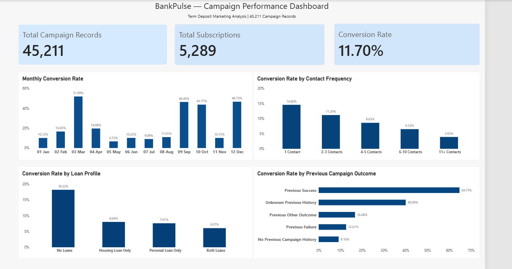
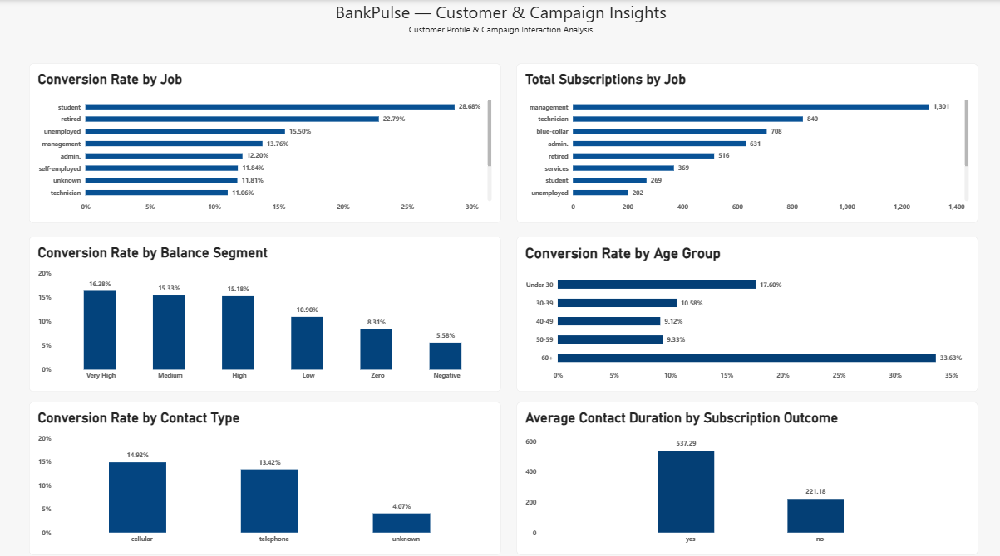

# BankPulse — Bank Marketing & Campaign Analytics

**PostgreSQL · SQL · Power BI · Data Validation · Business Analytics**

BankPulse is an end-to-end **descriptive analytics portfolio project** using the UCI Bank Marketing dataset, based on historical term-deposit marketing campaigns at a Portuguese bank. The project combines PostgreSQL analysis, independent data validation, and a two-page interactive Power BI report to examine campaign outcomes and support evidence-based business discussions.

**Business objective:** Understand which campaign-record groups have higher subscription rates, which contribute the most subscriptions, and where contact history and data quality warrant further investigation. These are *historical, observational findings*—not evidence of deployed improvements or causal effects.

## Project overview

| KPI | Verified result |
|---|---:|
| Campaign records | **45,211** |
| Subscriptions (`subscribed = 'yes'`) | **5,289** |
| Non-subscriptions | **39,922** |
| Overall subscription rate | **11.70%** |
| Unknown contact type | **13,020 records (28.80%)** |
| Power BI report | **2 pages** |

**Data grain:** Each row represents a campaign record, **not necessarily a unique customer**. The source does not contain a verified unique customer identifier; the PostgreSQL `customer_id` is a generated row key. KPI definitions and independent CSV calculations are documented in the [KPI dictionary](docs/kpi_dictionary.md) and [validation report](docs/validation_report.md).

## Business questions and verified findings

| Business question | Evidence | Business interpretation |
|---|---|---|
| **Higher conversion or more subscriptions?** | `student`: **269 / 938 = 28.68%**; `management`: **1,301 / 9,458 = 13.76%**. Management contributes **24.60%** of all subscriptions. | Report both **conversion rate and subscription volume**. Higher rates do not necessarily mean more total subscriptions. |
| **How does previous campaign outcome relate to subscription?** | Previous `success`: **978 / 1,511 = 64.73%**; previous `unknown`: **3,386 / 36,959 = 9.16%**. | Investigate previous-outcome completeness and comparable groups before recommending action. |
| **How does contact frequency relate to response?** | One contact: **14.60%** conversion; 11+ contacts: **3.93%**. | Explore campaign mix, contact strategy, and audience differences. The comparison does **not** prove extra contacts cause lower conversion. |
| **Do unknown values change reported performance?** | Known contact types: **4,759 / 32,191 = 14.78%**, versus **11.70%** overall. | Document filtering choices and denominators; do not silently drop `unknown` values. |

For supporting SQL queries, complete counts, limitations, and proposed next investigations, see the [Business Decision Brief](docs/business_decision_brief.md). **No causal impact, campaign uplift, or return on investment was measured.**

## Power BI dashboard

### Page 1 — Campaign Overview



Presents overall campaign records, subscriptions, conversion rate, and comparisons by calendar month, contact frequency, loan profile, and previous campaign outcome.

### Page 2 — Customer & Campaign Insights



Explores job-category conversion rates versus subscription counts, account-balance and age segments, contact types, and average call duration by subscription outcome.

**Editable report:** [BankPulse_Dashboard.pbix](powerbi/BankPulse_Dashboard.pbix)

**Additional review:** [Power BI KPI cross-check](docs/powerbi_crosscheck.md) · [Offline report audit](docs/powerbi_structural_audit.md)

**Important chart limitations:**

- The source contains contact day and month but **no year**. The monthly comparison is a calendar-month grouping, **not** a valid chronological or year-over-year trend.
- The reported **40.00%** for a small `Unknown Previous History` group is based on **2 subscriptions among only 5 records**; it should not support a strong decision by itself.
- Call duration is available during/after a call. It is suitable for retrospective analysis but **not as a pre-call prediction feature**.
- Selecting a bar may filter or highlight other visuals and KPI cards. Clear the selection to return to the overall totals.

## Skills demonstrated

- **SQL and PostgreSQL:** Data-quality checks, grouped aggregations, `CASE` expressions, CTEs, window functions, segmentation, campaign analysis, and validation queries.
- **Power BI:** KPI cards, comparisons, interactive report pages, cross-highlighting, and PostgreSQL data refresh.
- **Python (standard library):** Independent metric calculations, automated tests, and offline checks of the report package and screenshots.
- **Reproducibility and QA:** Data-grain definitions, numerator/denominator reconciliation, setup scripts, validation documentation, and a GitHub Actions PostgreSQL integration workflow.

## Repository structure

```text
BankPulse/
├── .github/workflows/postgres-ci.yml
├── .gitignore
├── README.md
├── data/
│   ├── DATA_SOURCE.md
│   └── raw/bank-full.csv
├── docs/
│   ├── analysis_summary.md
│   ├── business_decision_brief.md
│   ├── kpi_dictionary.md
│   ├── powerbi_crosscheck.md
│   ├── powerbi_structural_audit.md
│   ├── quality_assurance.md
│   └── validation_report.md
├── powerbi/BankPulse_Dashboard.pbix
├── screenshots/
│   ├── campaign_overview.png
│   └── customer_campaign_insights.png
├── scripts/
│   ├── audit_powerbi_report.py
│   ├── setup_and_import.psql
│   ├── validate_metrics.py
│   └── verify_postgres.sh
├── sql/
│   ├── 01_database_setup.sql
│   ├── 02_data_quality.sql
│   ├── 03_exploratory_analysis.sql
│   ├── 04_customer_segmentation.sql
│   ├── 05_campaign_analysis.sql
│   ├── 06_advanced_analysis.sql
│   ├── 07_business_validation.sql
│   └── 08_native_postgres_assertions.sql
└── tests/
    ├── test_assets.py
    ├── test_dashboard_reference_values.py
    ├── test_metrics.py
    └── test_sql_queries.py
```

## Reproduce and verify

### 1. Run Python checks

**Requirements:** Python 3.9+. No third-party Python packages or API keys are needed for these checks.

Open a terminal **in the project root** (the inner `BankPulse` folder that contains `README.md`, `tests/`, and `sql/`):

```powershell
python -m unittest discover -s tests -v
python scripts/validate_metrics.py --report docs/validation_report.md
python scripts/audit_powerbi_report.py --check
```

The test suite validates source-data counts, selected SQL logic using an SQLite compatibility database, screenshot reference values, and repository assets. **SQLite is not a substitute for running queries in PostgreSQL.**

**Power BI revision control:** The offline audit accepts the original and the reviewed refreshed/saved `.pbix` supplied by the project owner. It checks an approved SHA-256 digest, package integrity, unchanged page/visual definitions and expected field references. Another Power BI save may change the file again; an unreviewed version will fail the digest check until compared and approved. It does **not** independently evaluate DAX or the compressed model.

### 2. Set up PostgreSQL, if starting from an empty database

**Requirements:** PostgreSQL and its `psql` command-line client. Create an **empty** database named `bankpulse`; then, from the project root:

```powershell
psql -U postgres -d bankpulse -v ON_ERROR_STOP=1 -f scripts/setup_and_import.psql
```

The import maps the 17 source CSV columns into the database schema and generates `customer_id` separately. **Do not run the import against an existing populated database or commit a database password.**

If you already have the table populated, **skip the import** and verify its baseline in pgAdmin:

```sql
SELECT
    COUNT(*) AS campaign_records,
    COUNT(*) FILTER (WHERE subscribed = 'yes') AS subscriptions,
    ROUND(
        100.0 * COUNT(*) FILTER (WHERE subscribed = 'yes') /
        NULLIF(COUNT(*), 0), 2
    ) AS conversion_rate_pct
FROM public.bank_marketing_raw;
```

Expected: **45,211 campaign records, 5,289 subscriptions, 11.70% conversion**. Matching totals do not by themselves prove that every source record is identical; check the schema and relevant segmentation assertions as well.

### 3. Run native PostgreSQL analysis

Execute the following files using pgAdmin Query Tool or `psql`, in order:

| SQL script | Purpose |
|---|---|
| [02_data_quality.sql](sql/02_data_quality.sql) | Missing/unknown values, ranges, and duplicate checks |
| [03_exploratory_analysis.sql](sql/03_exploratory_analysis.sql) | Descriptive performance and demographic comparisons |
| [04_customer_segmentation.sql](sql/04_customer_segmentation.sql) | Exploratory category and profile segmentation |
| [05_campaign_analysis.sql](sql/05_campaign_analysis.sql) | Contact patterns, previous outcomes, and duration |
| [06_advanced_analysis.sql](sql/06_advanced_analysis.sql) | CTEs, window functions, rankings, and calendar-month comparisons |
| [07_business_validation.sql](sql/07_business_validation.sql) | Business evidence, reconciliation, and unknown-value sensitivity |
| [08_native_postgres_assertions.sql](sql/08_native_postgres_assertions.sql) | PostgreSQL-native KPI and segmentation assertions |

Files 02–07 are read-only analyses; file 08 raises an error if its assertions fail. The provided [verification script](scripts/verify_postgres.sh) automates a fresh-database import and these checks in a Bash environment; **do not point its import step at a populated database**.

### 4. Open and refresh Power BI

1. Open [BankPulse_Dashboard.pbix](powerbi/BankPulse_Dashboard.pbix) in Power BI Desktop (Windows).
2. Check that its PostgreSQL data source points to your intended database; update local credentials if prompted.
3. Select **Home → Refresh** and ensure the operation completes without errors.
4. Clear report selections and compare the three KPI cards with **45,211**, **5,289**, and **11.70%**.
5. Select and deselect bars on both pages to confirm cross-filtering/highlighting and return to the overall totals.
6. Refer to the [Power BI KPI cross-check](docs/powerbi_crosscheck.md) for additional independent comparisons.

### 5. Verify GitHub Actions after pushing

The [GitHub Actions workflow](.github/workflows/postgres-ci.yml) is configured to run Python checks and SQL tests against a **PostgreSQL 17 service** on pushes to `main` or `master`, pull requests, and manual dispatches.

After uploading, open the repository's **Actions** tab and confirm the workflow **actually finishes successfully**. A workflow file in the repository is not evidence of a passed run.

## Verification evidence and current scope

| Validation | Status |
|---|---|
| Independent CSV metrics and reconciliation | **Passed** |
| Python automated suite | **22 tests passed** for the reviewed and refreshed `.pbix` in this packaged release |
| PostgreSQL baseline and expected 18-column table schema | **Passed** on the project owner's local database |
| SQL scripts 02–07 in native PostgreSQL | **Executed successfully** in pgAdmin, as reported during local testing |
| PostgreSQL KPI and segmentation assertions (08) | **Passed** locally |
| Power BI Desktop refresh | **Passed** locally without errors |
| Three main Power BI KPI cards versus PostgreSQL | **Matched:** 45,211; 5,289; 11.70% |
| Cross-filtering and selection reset on both report pages | **Checked successfully** locally |
| Independent validation of every DAX expression and visual calculation | **Not exhaustively validated** |
| GitHub Actions PostgreSQL 17 integration after push | **Pending first confirmed successful run** |

These statuses distinguish local checks from pending GitHub CI. The [quality assurance notes](docs/quality_assurance.md), [PBIX revision comparison](docs/powerbi_revision_comparison.md), and [offline audit](docs/powerbi_structural_audit.md) document the updated saved report. **The offline PBIX audit is passing for this included revision.**

## Dataset attribution and limitations

- **Dataset:** Moro, S., Rita, P., and Cortez, P. (2014), *Bank Marketing*, UCI Machine Learning Repository — [source page](https://archive.ics.uci.edu/dataset/222/bank+marketing). Full attribution and licensing details are in [DATA_SOURCE.md](data/DATA_SOURCE.md).
- The project uses **`bank-full.csv` (45,211 rows)**, not the different 41,188-row `bank-additional-full.csv` version.
- `unknown` is a source category; it should not automatically be interpreted as SQL `NULL` or as no contact history.
- The dataset lacks a verified unique customer identifier and a year field. Do not claim distinct-customer counts or year-over-year trends.
- Age, occupation, and financial characteristics are studied descriptively—not proposed as automated individual financial-product eligibility or targeting rules. Real operational use would require privacy, fairness, consent, and compliance review.
- This is a **historical portfolio case study**, not a deployed bank application, real-time data pipeline, or measured business intervention.

**Project outcome:** A reproducible SQL and Power BI case study demonstrating data validation, KPI reporting, campaign analysis, and responsible business interpretation.
